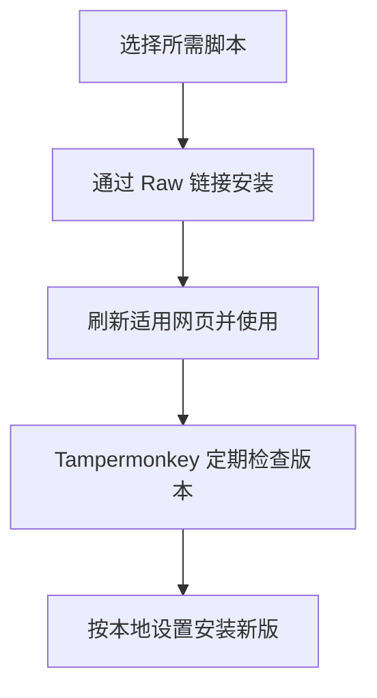

<!-- readme-skill:begin hero -->
# P9_Tampermonkey

P9 的 Tampermonkey 用户脚本集合。每个脚本放在独立文件夹中，分别安装、启用和更新。
<!-- readme-skill:end hero -->

<!-- readme-skill:begin scripts -->
## 脚本目录

| 脚本 | 版本 | 用途 | 安装 | 说明 |
| --- | --- | --- | --- | --- |
| P9 Royal Mail CSV Processor | 1.1.1 | 在 Royal Mail Click & Drop 页面处理 Cardmarket CSV，生成邮寄服务、订单 reference 和 SKU | [安装脚本](https://raw.githubusercontent.com/tjx0726/P9_Tampermonkey/main/royal-mail-csv/royal-mail-csv.user.js) | [使用说明](royal-mail-csv/README.md) |
<!-- readme-skill:end scripts -->

<!-- readme-skill:begin installation -->
## 安装与更新

1. 在浏览器中安装并启用 [Tampermonkey](https://www.tampermonkey.net/)。
2. 点击上方对应脚本的「安装脚本」链接，在 Tampermonkey 页面确认安装。
3. 刷新脚本适用的网页，按该脚本的使用说明操作。

已有手动复制安装的 Royal Mail 脚本时，也需要通过上方链接安装一次本仓库版本，以保存更新地址。若提示更新现有脚本，确认更新；安装后检查只保留一个启用的副本。

每个脚本的 `@updateURL` 和 `@downloadURL` 指向本仓库 `main` 分支中自己的文件。Tampermonkey 按本地检查周期比较 `@version`，并根据「自动安装」设置处理新版。请在 Tampermonkey 中启用更新检查，并按需要启用自动安装。


<!-- readme-skill:end installation -->

<!-- readme-skill:begin structure -->
## 文件结构

```text
P9_Tampermonkey/
├── README.md
├── CHANGELOG.md
└── royal-mail-csv/
    ├── README.md
    ├── royal-mail-csv.user.js
    ├── package.json
    └── test/
        ├── rules.test.cjs
        └── fixtures/
            └── orders.csv
```

`orders.csv` 是虚构的测试数据。实际订单、处理结果、浏览器截图和凭据不应提交到此公开仓库。
<!-- readme-skill:end structure -->

<!-- readme-skill:begin maintenance -->
## 维护与新增脚本

- 每个脚本使用独立文件夹，包含自己的 `.user.js` 和使用说明。
- 发布改动时提高该脚本的 `@version`；有 `package.json` 时同步版本号。
- 保持更新地址中的文件路径稳定，并指向 `main` 分支。
- 提交前执行该脚本的本地检查，更新上方目录和根目录 [CHANGELOG](CHANGELOG.md)。
- 新增到仓库的脚本需要用户单独安装一次。

Royal Mail 脚本的本地检查：

```sh
cd royal-mail-csv
npm run check
npm test
```

测试使用 Node.js 内置测试运行器，无需安装 npm 依赖；安装和使用脚本本身无需 Node.js 或构建步骤。
<!-- readme-skill:end maintenance -->
