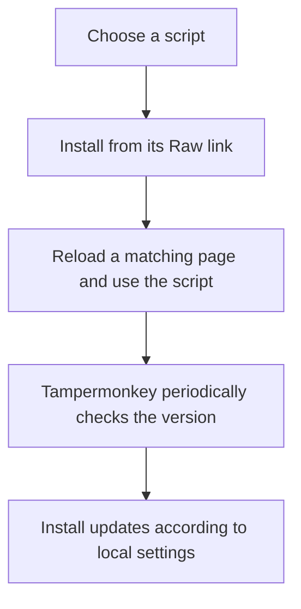

<!-- readme-skill:begin hero -->
# P9_Tampermonkey

[English](README.md) · [中文](README.zh-CN.md)

Tampermonkey userscripts for P9's internal use. Each script lives in its own folder and is installed, enabled, and updated independently. `README.md` is the default English guide; `README.zh-CN.md` is the Chinese edition.
<!-- readme-skill:end hero -->

<!-- readme-skill:begin scripts -->
## Script catalog

| Script | Version | Purpose | Install | Documentation |
| --- | --- | --- | --- | --- |
| P9 Royal Mail CSV Processor | 1.1.1 | Process Cardmarket CSV exports on Royal Mail Click & Drop, generating shipping services, order references, and SKUs | [Install script](https://raw.githubusercontent.com/tjx0726/P9_Tampermonkey/main/royal-mail-csv/royal-mail-csv.user.js) | [English](royal-mail-csv/README.md) · [中文](royal-mail-csv/README.zh-CN.md) |
| P9 Order Tools for TCG PowerTools | 1.1.2 | Read Royal Mail label PDFs, match Cardmarket IDs and PIDs, add tracking, and refresh orders after native saves | [Install script](https://raw.githubusercontent.com/tjx0726/P9_Tampermonkey/main/tcgpowertools-tracking/tcgpowertools-royal-mail-tracking.user.js) | [English](tcgpowertools-tracking/README.md) · [中文](tcgpowertools-tracking/README.zh-CN.md) |
| TCG PowerTools - Stay on Legacy App | 1.0.2 | Block navigation from the legacy TCG PowerTools app to the new app's login-redirect endpoint | [Install script](https://raw.githubusercontent.com/tjx0726/P9_Tampermonkey/main/tcgpowertools-block-redirect/tcgpowertools-stay-on-legacy.user.js) | [English](tcgpowertools-block-redirect/README.md) · [中文](tcgpowertools-block-redirect/README.zh-CN.md) |
<!-- readme-skill:end scripts -->

<!-- readme-skill:begin installation -->
## Installation and updates

1. Install and enable [Tampermonkey](https://www.tampermonkey.net/) in your browser.
2. Follow the relevant **Install script** link above and confirm installation in Tampermonkey.
3. Reload a page where the script applies and follow that script's documentation.

If you previously installed a script by copying its source or from a local URL without an update source, install this repository's version once through the relevant link above to register its update URLs. Confirm an update if prompted, and keep only one enabled copy of each script.

Each script's `@updateURL` and `@downloadURL` point to its own file on this repository's `main` branch. Tampermonkey compares `@version` at the locally configured interval and handles new versions according to the **Automatic installation** setting. Enable update checks in Tampermonkey and enable automatic installation if desired.


<!-- readme-skill:end installation -->

<!-- readme-skill:begin structure -->
## Repository structure

```text
P9_Tampermonkey/
├── .agents/
│   └── .gitkeep
├── AGENTS.md
├── README.md
├── README.zh-CN.md
├── CHANGELOG.md
├── royal-mail-csv/
│   ├── README.md
│   ├── README.zh-CN.md
│   ├── royal-mail-csv.user.js
│   ├── package.json
│   └── test/
│       ├── rules.test.cjs
│       └── fixtures/
│           └── orders.csv
├── tcgpowertools-block-redirect/
│   ├── README.md
│   ├── README.zh-CN.md
│   └── tcgpowertools-stay-on-legacy.user.js
└── tcgpowertools-tracking/
    ├── README.md
    ├── README.zh-CN.md
    ├── tcgpowertools-royal-mail-tracking.user.js
    ├── package.json
    └── test/
        ├── importer.test.cjs
        ├── refresh.test.cjs
        └── pdf-sample.test.cjs
```

`orders.csv` contains fictional test data. Do not commit real orders, processed output, browser screenshots, or credentials to this public repository.
<!-- readme-skill:end structure -->

<!-- readme-skill:begin maintenance -->
## Maintenance and new scripts

- Give each script its own folder containing its `.user.js`, an English `README.md`, and any required supporting files. A Chinese `README.zh-CN.md` is optional; if present, keep it synchronized with the English guide.
- Increase that script's `@version` when publishing changes, and synchronize `package.json` if one exists.
- Keep the update URL's file path stable and point it to the `main` branch.
- Run the script's local checks before committing, then update the catalog above and the root [CHANGELOG](CHANGELOG.md).
- A newly added script requires a separate one-time installation by each user.

Local checks for the Royal Mail CSV script:

```sh
cd royal-mail-csv
npm run check
npm test
```

Local checks for the tracking script:

```sh
cd tcgpowertools-tracking
npm run check
npm test
```

The unit tests use Node.js's built-in test runner and require no npm dependencies. The tracking script's optional PDF integration checks require a local PDF.js module and private PDF/expectation files; see its guide. Installing and using the userscripts themselves requires neither Node.js nor a build step.
<!-- readme-skill:end maintenance -->
