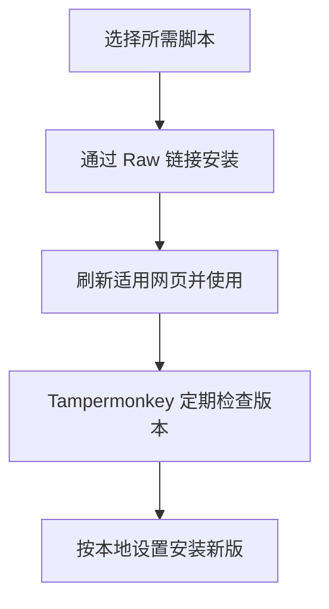

<!-- readme-skill:begin hero -->
# P9_Tampermonkey

[English](README.md) · [中文](README.zh-CN.md)

供 P9 内部使用的 Tampermonkey 用户脚本集合。每个脚本放在独立文件夹中，分别安装、启用和更新。默认英文文档为 `README.md`，中文版为 `README.zh-CN.md`。
<!-- readme-skill:end hero -->

<!-- readme-skill:begin scripts -->
## 脚本目录

| 脚本 | 版本 | 用途 | 安装 | 说明 |
| --- | --- | --- | --- | --- |
| P9 Royal Mail CSV Processor | 1.1.2 | 处理 TCGPowerTools 导出的 CSV。 | [安装脚本](https://raw.githubusercontent.com/tjx0726/P9_Tampermonkey/main/royal-mail-csv/royal-mail-csv.user.js) | [English](royal-mail-csv/README.md) · [中文](royal-mail-csv/README.zh-CN.md) |
| P9 TCGPowerTools | 1.2.3 | Tracking 导入、库存冷却控制、原生订单刷新、默认开启的旧版跳转保护，以及新版域名入口和设置 | [安装脚本](https://raw.githubusercontent.com/tjx0726/P9_Tampermonkey/main/p9-tcgpowertools/p9-tcgpowertools.user.js) | [English](p9-tcgpowertools/README.md) · [中文](p9-tcgpowertools/README.zh-CN.md) |
| TCG PowerTools - Stay on Legacy App（仅兼容旧安装） | 1.0.3 | 为已有安装保留，功能现已合并至 P9 TCGPowerTools | [使用合并插件](https://raw.githubusercontent.com/tjx0726/P9_Tampermonkey/main/p9-tcgpowertools/p9-tcgpowertools.user.js) | [English](tcgpowertools-block-redirect/README.md) · [中文](tcgpowertools-block-redirect/README.zh-CN.md) |
<!-- readme-skill:end scripts -->

<!-- readme-skill:begin installation -->
## 安装与更新

1. 在浏览器中安装并启用 [Tampermonkey](https://www.tampermonkey.net/)。
2. 点击上方对应脚本的「安装脚本」链接，在 Tampermonkey 页面确认安装。
3. 刷新脚本适用的网页，按该脚本的使用说明操作。

已有手动粘贴或从本地地址安装、没有更新来源的脚本时，需要通过上方对应链接安装一次本仓库版本，以保存更新地址。若提示更新现有脚本，确认更新；安装后检查每个脚本只保留一个启用的副本。

安装 **P9 TCGPowerTools** 后，请停用旧名称 tracking 导入器和独立 **Stay on Legacy App** 脚本，合并插件已包含拦截功能。在 `new.tcgpowertools.com` 当前仅提供入口和共享设置，库存及 tracking 操作保持禁用。

插件的主目录和文件现统一为 `p9-tcgpowertools/p9-tcgpowertools.user.js`。旧更新地址保留迁移副本；已有安装完成一次更新后，后续从新地址检查更新。

每个脚本的 `@updateURL` 和 `@downloadURL` 指向本仓库 `main` 分支中自己的文件。Tampermonkey 按本地检查周期比较 `@version`，并根据「自动安装」设置处理新版。请在 Tampermonkey 中启用更新检查，并按需要启用自动安装。


<!-- readme-skill:end installation -->

<!-- readme-skill:begin structure -->
## 文件结构

```text
P9_Tampermonkey/
├── .agents/
│   └── .gitkeep
├── AGENTS.md
├── README.md
├── README.zh-CN.md
├── CHANGELOG.md
├── royal-mail-csv/
│   ├── README.md
│   ├── README.zh-CN.md
│   ├── royal-mail-csv.user.js
│   ├── package.json
│   └── test/
│       ├── rules.test.cjs
│       └── fixtures/
│           └── orders.csv
├── tcgpowertools-block-redirect/
│   ├── README.md
│   ├── README.zh-CN.md
│   └── tcgpowertools-stay-on-legacy.user.js
├── tcgpowertools-tracking/  (migration only)
│   ├── README.md
│   ├── README.zh-CN.md
│   └── tcgpowertools-royal-mail-tracking.user.js
└── p9-tcgpowertools/
    ├── README.md
    ├── README.zh-CN.md
    ├── p9-tcgpowertools.user.js
    ├── package.json
    └── test/
        ├── importer.test.cjs
        ├── refresh.test.cjs
        ├── pdf-sample.test.cjs
        └── tools.test.cjs
```

`orders.csv` 是虚构的测试数据。实际订单、处理结果、浏览器截图和凭据不应提交到此公开仓库。
<!-- readme-skill:end structure -->

<!-- readme-skill:begin maintenance -->
## 维护与新增脚本

- 每个脚本使用独立文件夹，包含自己的 `.user.js`、英文 `README.md` 和所需配套文件。中文 `README.zh-CN.md` 可选；提供时应与英文说明同步维护。
- 发布改动时提高该脚本的 `@version`；有 `package.json` 时同步版本号。
- 保持更新地址中的文件路径稳定，并指向 `main` 分支。
- 提交前执行该脚本的本地检查，更新上方目录和根目录 [CHANGELOG](CHANGELOG.md)。
- 新增到仓库的脚本需要用户单独安装一次。

Royal Mail CSV 脚本的本地检查：

```sh
cd royal-mail-csv
npm run check
npm test
```

P9 TCGPowerTools 的本地检查：

```sh
cd p9-tcgpowertools
npm run check
npm test
```

单元测试使用 Node.js 内置测试运行器，无需安装 npm 依赖。P9 TCGPowerTools 的可选 PDF 集成检查需要本地 PDF.js 模块和私有 PDF/预期结果文件，详见其说明。安装和使用脚本本身无需 Node.js 或构建步骤。
<!-- readme-skill:end maintenance -->
