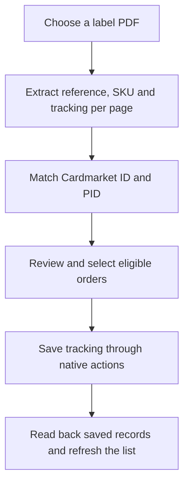

# P9 TCGPowerTools

[English](README.md) · [中文](README.zh-CN.md)

An English Tampermonkey interface for TCG PowerTools. On the legacy app it imports tracking from Royal Mail PDFs, refreshes orders after native saves, and optionally unlocks stock refresh during cooldown. Legacy redirect protection is included and enabled by default.

| Domain | Available features |
| --- | --- |
| `app.tcgpowertools.com` | Tracking import, stock cooldown control, native order refresh, and legacy redirect protection |
| `new.tcgpowertools.com` | Plugin launcher and shared Settings only; stock and tracking actions are disabled |

## Installation and updates

1. Install and enable [Tampermonkey](https://www.tampermonkey.net/).
2. Open [Install script](https://raw.githubusercontent.com/tjx0726/P9_Tampermonkey/main/p9-tcgpowertools/p9-tcgpowertools.user.js) and confirm installation or update.
3. Reload either supported domain and click **P9 TCGPowerTools** at the bottom right.

Current version: **1.2.3**. The canonical folder is `p9-tcgpowertools`, the userscript is `p9-tcgpowertools.user.js`, and the package is `p9-tcgpowertools`. The script name and namespace are unchanged; homepage and update URLs now use the new directory. The former Raw URL retains a complete 1.2.1 migration copy so existing installations move to the new update URL. Disable any remaining older tracking copy and the separate **TCG PowerTools - Stay on Legacy App** script; keep one merged plugin enabled. A pasted or local copy without an update source needs a one-time installation through the link above. Future checks use `main` and follow Tampermonkey settings.

## Menu and use

- **Add Tracking Number** opens the PDF import view.
- **Placeholder** is disabled and reserved for a future feature.
- **Force Refresh Stock** invokes the site's original stock refresh once on the legacy **Your Stock** page, even during cooldown. On another legacy page it explains where to open the action.
- **Settings** contains shared redirect, cooldown, and order-refresh preferences.

The menu shows the installed script version. Opening it does not request orders or stock. Page navigation and native DOM updates synchronize the cooldown control; the plugin has no recurring page task. Only starting **Force Refresh Stock** closes the plugin window to make room for the site's loading or confirmation dialog.

Choose a shipping label PDF, review the PID, Cardmarket order ID, PDF tracking, current tracking, and match result, then select the required orders. Enable **Allow overwriting different tracking numbers** when replacing an existing value. Identical values are skipped. **Add tracking to N selected orders** saves selected orders sequentially and verifies the server records.

**Back to Menu** preserves the PDF preview. Navigation and closing are disabled while a PDF is loading or a batch is being saved.



PDFs are read locally. Mozilla PDF.js 5.6.205 and its worker are loaded on demand from jsDelivr; the PDF is not uploaded to that CDN. Saving sends selected order IDs and tracking numbers to the current TCG PowerTools account.

## Settings

| Setting | Default | Behavior |
| --- | --- | --- |
| **Stay on Legacy App** | On | Cancel cancelable navigation from the legacy app to the new app's exact `/login-redirect` path. Other destinations remain available. |
| **Allow stock refresh during cooldown** | Off | Unlock the original **Refresh Stock** control on the legacy **Your Stock** page while its local one-hour timer is active. Turning it off restores native disabled state. |
| **Automatically refresh the order list after native tracking, packed, or sent changes** | On | Reload orders after successful native saves without resetting workflow, filters, or search. |

Preferences are stored with Tampermonkey's `GM_getValue`/`GM_setValue` and synchronized between open legacy and new-domain tabs. You can change **Stay on Legacy App** on the new domain and it takes effect on the legacy domain immediately. Existing local preferences are migrated; local storage is a fallback when userscript storage is unavailable. Preferences do not transfer to another browser installation.

The cooldown switch and manual menu action call the native button's existing React event handler once, preserving the site's stock hydration, local-edit confirmation, loading view, and errors. There is no polling refresh schedule or automatic retry. A successful request does not establish that Cardmarket generated a new export instead of reusing cached data. The button adapter supports both disabled buttons and `aria-disabled` menuitems; if the site's event binding changes, it fails closed.

The script observes successful native XHR/fetch saves, reads `GET /api/user/order`, and updates the existing Zustand store through its public interface. The selected workflow, filters, and search remain in place.

## Matching and saving

All identifiers below are fictional examples.

- One label per page is supported. The original combined reference, `Customer Ref: 90001 / A17 (20) 9900000017`, remains compatible.
- The split format reads the Cardmarket ID from `Customer Ref: 90001 / 9900000017` (or the bare order ID) and the PID from the separate SKU, `A17 (20)`. Royal Mail's prefix, such as `20x A17 (20)`, is kept separate from the order ID. A printed `SKU` heading is optional; PDF field paint order does not affect pairing.
- Missing SKU data, conflicting PID/quantity tokens, or multiple reference headings block the label. Fields are never paired across pages.
- Tracking such as `QM 9000 0001 9GB` is normalized to `QM900000019GB`. Identifiers remain strings, including leading zeros in PIDs.
- The Cardmarket ID must match exactly one order, and its `pt.picking.pickingId` must match the PDF PID. A recycled PID is never the only lookup key.
- Missing orders or fields, PID mismatches, scans without a text layer, ambiguous pages, conflicting labels, and tracking shared across different orders are blocked. Identical duplicate labels are skipped after the first occurrence.
- Selected orders are rechecked before saving. Rows whose tracking changed after the preview are skipped for review.

Saving follows the native tracking dialog's two requests:

1. `PUT /api/user/order/setTrackingNumber` with `{ idOrder, trackingNumber }`.
2. `PUT /api/user/order/changeOrderProp` with `{ idOrder, prop: "trackingNumber", value }`.

The first response must confirm the exact order ID and tracking before the local property is updated. A final GET must confirm the saved local tracking. Failed, partial, or uncertain writes stop the batch and are not automatically retried. Importing tracking does not change packed or sent statuses.

The Cardmarket cache can retain old tracking after a successful save. The script verifies the upstream response and local record separately, then displays the saved local value. It does not rewrite the server's Cardmarket cache.

The already-loaded webpack store is discovered without fixed module IDs or React fibers. A site architecture change may require an adapter update; saving stops before any write if the store cannot be found.

## Validation

```sh
npm run check
npm test
```

The suite has 44 dependency-free checks and two optional PDF integration checks. It covers both reference formats, matching and safe saves, native order refresh, default redirect protection, cross-domain preferences, cooldown unlock/restoration, native single-flight refresh, userscript isolation, inaccessible third-party exports, and standalone-blocker coexistence. Mounted-interface checks cover opening menus on supported routes, reopening after stock refresh, and synchronizing cooldown controls during SPA navigation without polling.

Real PDFs and independently checked expected records stay outside this public repository. Each expectations file is a JSON array of `{ page, orderCode, cardmarketOrderId, trackingNumber, error }`. Supply both PDFs and their private expectation files to run all 46 checks:

```sh
LABEL_PDF='/private/path/combined-label.pdf' LABEL_EXPECTATIONS='/private/path/combined-expected.json' SPLIT_LABEL_PDF='/private/path/split-label.pdf' SPLIT_LABEL_EXPECTATIONS='/private/path/split-expected.json' PDFJS_MODULE='/absolute/path/to/pdfjs-dist/legacy/build/pdf.mjs' npm test
```

Without the corresponding PDF variable, that integration check is skipped. The public unit tests contain fictional identifiers; actual labels, account records, screenshots, and account-specific fixture generators are excluded.

On 2026-11-19, both the original five-page export and a newly generated split-format Royal Mail label passed local PDF.js extraction. Tabbit and Tampermonkey browser uploads verified the English menu and extracted fields. Earlier five-order save/readback tests restored the original tracking afterward. Packed/sent refresh was checked with simulated requests without changing shipping statuses.

## Disable

Disable or remove this script in Tampermonkey and reload the page to remove its interface and refresh hooks.

References: [Mozilla PDF.js](https://mozilla.github.io/pdf.js/examples/), [Tampermonkey documentation](https://www.tampermonkey.net/documentation.php).
