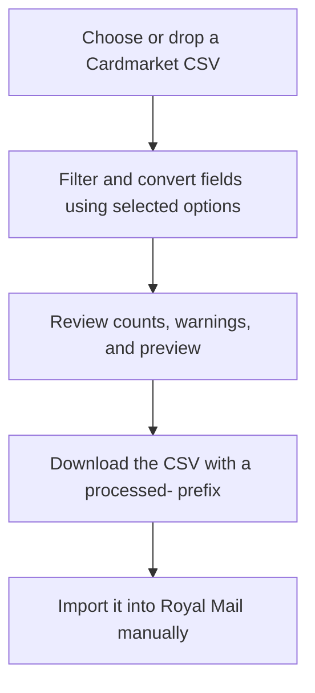

<!-- readme-skill:begin hero -->
# P9 Royal Mail CSV Processor

[English](README.md) · [简体中文](README.zh-CN.md)

Adds a **Process CSV** button to the bottom-right corner of [Royal Mail Click & Drop](https://business.parcel.royalmail.com/) to process and download Cardmarket CSV exports in your browser. Current version: **1.1.1**. The script's interface is in English.

[Install script](https://raw.githubusercontent.com/tjx0726/P9_Tampermonkey/main/royal-mail-csv/royal-mail-csv.user.js) · [Source](royal-mail-csv.user.js) · [Changelog](../CHANGELOG.md) · [Script catalog](../README.md)
<!-- readme-skill:end hero -->

<!-- readme-skill:begin installation -->
## Installation

1. Install and enable [Tampermonkey](https://www.tampermonkey.net/).
2. Follow **Install script** above and confirm installation or an update to the existing script.
3. Reload your signed-in Royal Mail Click & Drop page. **Process CSV** appears in the bottom-right corner.

Older versions installed by manually copying the source need a one-time installation through the link above to obtain this repository's automatic update URLs. Keep only one enabled copy in Tampermonkey and enable update checks and automatic installation as desired. The script requires no build step, npm dependencies, server, or API key.
<!-- readme-skill:end installation -->

<!-- readme-skill:begin usage -->
## Usage

1. Click **Process CSV** to expand the panel.
2. Choose or drop a UTF-8 Cardmarket CSV file, up to 20 MB.
3. Review the uploaded, kept, and removed order counts, warnings, and preview of the first five orders.
4. Toggle any of the three processing options as needed; changing an option reprocesses the original file.
5. Click **Download processed CSV**. For example, `orders.csv` downloads as `processed-orders.csv`.



CSV files are processed in the current browser. The script does not upload customer data, submit orders, or automatically import them into Royal Mail. Collapsing the panel preserves the current result; reloading the page requires choosing the file again.
<!-- readme-skill:end usage -->

<!-- readme-skill:begin mapping -->
## Order reference and printed SKU

| Output column | Value | Example | Royal Mail import mapping |
| --- | --- | --- | --- |
| `new_reference` | Cardmarket `idOrder`, preserved as text | `001234` | Order information → Order reference |
| `SKU` | `PID (articles)` | `A17 (20)` | Product information → Identifier (SKU) |

On the first import, map the new `SKU` column to **Identifier (SKU)** and keep `new_reference` mapped to **Order reference**. The original `PID`, `articles`, and `idOrder` columns remain in the file.

In Royal Mail's **Settings → Label format**, enable **Include product identifiers (SKUs) on label** and save. See the [Royal Mail label guide](https://help.parcel.royalmail.com/hc/en-gb/articles/115004866953-Choosing-your-label-format) and [CSV field specifications](https://help.parcel.royalmail.com/hc/en-gb/articles/360000250093-Order-Import-spreadsheet-field-specifications) for print fields and format limits. The script does not automatically change account settings or rewrite existing orders and labels.

A missing order number prevents processing. A missing PID or articles value produces a blank SKU with a warning. SKUs longer than 43 characters are preserved in full, with a warning to check label truncation. Verify the actual SKU printout after importing an order.
<!-- readme-skill:end mapping -->

<!-- readme-skill:begin rules -->
## Processing rules

All three options are enabled by default:

- **Remove orders with issues**: retain only orders whose `issues` value is empty, a missing value, or exactly `[]`.
- **Remove non-ASCII characters from addresses**: clean the name, extra address, street, city, and postcode fields. Characters are deleted without transliteration; for example, `José` becomes `Jos`.
- **Prepare shipping services, reference and SKU**: generate or overwrite `serviceCode`, `weight`, `format`, `new_reference`, and `SKU`. Disable this option to preserve existing generated column values; missing-value cleanup still runs.

The original column order and unrelated fields are preserved, and missing generated columns are appended. Fields are read as text to retain leading zeroes in order numbers, telephone numbers, postcodes, and counts. Missing-value strings are cleared consistently with the original processing rules.

| shippingMethod | Condition | serviceCode | weight | format |
| --- | --- | --- | --- | --- |
| UK Standard Letter (2nd Class) | All | BPL2 | 0.1 | Letter |
| UK Standard Large Letter (2nd Class) | articles > 50 | BPL2 | 0.3 | Large letter |
| UK Standard Large Letter (2nd Class) | Other valid counts or empty | BPL2 | 0.1 | Letter |
| UK Standard Letter (1st Class) | All | BPL1 | 0.1 | Letter |
| UK Standard Large Letter (1st Class) | All | BPL1 | 0.1 | Letter |
| UK Signed Large Letter (2nd Class Signed For) | All | TRS48 | 0.1 | Large letter |
| UK Signed Large Letter (1st Class Signed For) | All | TRN24 | 0.1 | Large letter |
| Tracked 48 (Real Tracked Service) | All | TRS48 | 0.1 | Large letter |
| Tracked 48 LBT (Real Tracked Service) | All | TRS48 | 0.1 | Large letter |
| UK Confirmed Large Letter (2nd Class Signed For) | All | TRS48 | 0.1 | Large letter |
| UK Signed Large Letter (2nd Class Signed For) (Online) | All | TRS48 | 0.1 | Large letter |
| Tracked 24 (Real Tracked Service) | All | TRN24 | 0.1 | Large letter |
| Special Delivery 1PM insured for 750 GBP | All | SD1 | 0.1 | Large letter |

Unmatched shipping methods leave the service code, weight, and format blank and produce a warning; check these orders before importing. If every order is filtered out, the script allows a header-only CSV download and displays a warning.
<!-- readme-skill:end rules -->

<!-- readme-skill:begin development -->
## Local checks

Run from this directory using Node.js's built-in test runner. No npm dependencies are required:

```sh
npm run check
npm test
```

`test/rules.test.cjs` contains 41 regression tests covering CSV parsing, filtering, address cleaning, shipping service mappings, separate references and SKUs, missing data, and repeated processing. `test/fixtures/orders.csv` contains fictional orders only.

Version 1.1.1 changes only distribution metadata and the version number; CSV processing and interface behavior are inherited from 1.1.0.
<!-- readme-skill:end development -->
