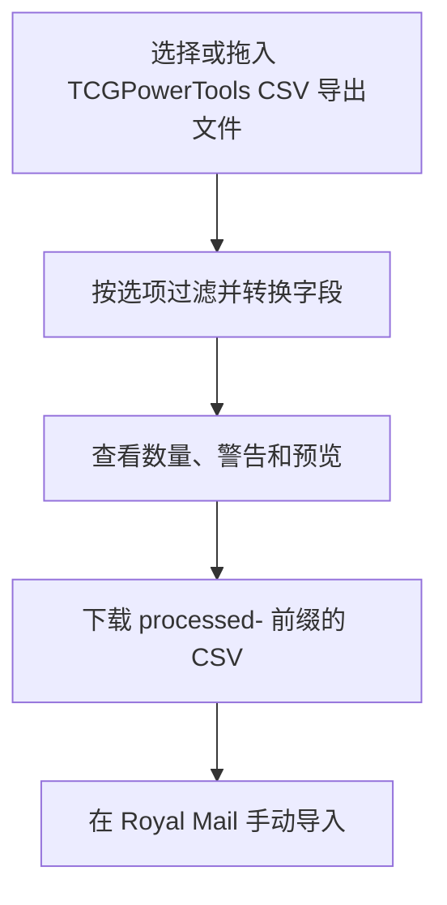

<!-- readme-skill:begin hero -->
# P9 Royal Mail CSV Processor

[English](README.md) · [中文](README.zh-CN.md)

在 [Royal Mail Click & Drop](https://business.parcel.royalmail.com/) 页面右下角添加 **Process CSV** 按钮，将 TCGPowerTools 导出的 CSV 在浏览器中处理并下载。当前版本：**1.1.2**。脚本界面为英文。

[安装脚本](https://raw.githubusercontent.com/tjx0726/P9_Tampermonkey/main/royal-mail-csv/royal-mail-csv.user.js) · [脚本源码](royal-mail-csv.user.js) · [更新记录](../CHANGELOG.md) · [返回脚本目录](../README.md)
<!-- readme-skill:end hero -->

<!-- readme-skill:begin installation -->
## 安装

1. 安装并启用 [Tampermonkey](https://www.tampermonkey.net/)。
2. 点击上方「安装脚本」，确认安装或更新现有脚本。
3. 刷新已登录的 Royal Mail Click & Drop 页面，右下角会出现 **Process CSV**。

手动复制安装的旧版本需通过上述链接安装一次，以获得本仓库的自动更新地址。检查 Tampermonkey 中只保留一个启用的副本，并按需要启用更新检查和自动安装。脚本无需构建、npm 依赖、服务器或 API key。
<!-- readme-skill:end installation -->

<!-- readme-skill:begin usage -->
## 使用

1. 点击 **Process CSV** 展开窗口。
2. 选择或拖入 UTF-8 编码的 TCGPowerTools CSV 导出文件，文件上限为 20 MB。
3. 查看上传、保留、删除的订单数量、警告和前五条订单预览。
4. 按需切换三个处理选项；选项改变后会重新处理原始文件。
5. 点击 **Download processed CSV**，例如 `orders.csv` 下载为 `processed-orders.csv`。



CSV 在当前浏览器内处理；脚本不会上传客户数据、提交订单或自动导入 Royal Mail。收起窗口会保留当前结果，刷新网页后需要重新选择文件。
<!-- readme-skill:end usage -->

<!-- readme-skill:begin mapping -->
## 订单 reference 与面单 SKU

| 输出列 | 内容 | 示例 | Royal Mail 导入映射 |
| --- | --- | --- | --- |
| `new_reference` | Cardmarket 的 `idOrder`，以文本保留 | `001234` | Order information → Order reference |
| `SKU` | `PID (articles)` | `A17 (20)` | Product information → Identifier (SKU) |

首次导入时，将新增 `SKU` 列映射到 **Identifier (SKU)**；保持 `new_reference` 映射到 **Order reference**。原始的 `PID`、`articles` 和 `idOrder` 列仍会保留。

在 Royal Mail 的 **Settings → Label format** 中启用 **Include product identifiers (SKUs) on label**，并保存。打印字段和格式限制可查阅 [Royal Mail 标签说明](https://help.parcel.royalmail.com/hc/en-gb/articles/115004866953-Choosing-your-label-format) 和 [CSV 字段规格](https://help.parcel.royalmail.com/hc/en-gb/articles/360000250093-Order-Import-spreadsheet-field-specifications)。脚本不会自动修改账户设置或重写已有订单及面单。

缺失订单号会阻止处理；缺失 PID 或 articles 会生成空 SKU 并显示警告。SKU 超过 43 个字符时保留完整值，同时提示核对面单上的截断情况。实际 SKU 打印效果需要在完成导入后核对。
<!-- readme-skill:end mapping -->

<!-- readme-skill:begin rules -->
## 处理规则

三个选项默认全部启用：

- **Remove orders with issues**：只保留 `issues` 为空、缺失值或严格等于 `[]` 的订单。
- **Remove non-ASCII characters from addresses**：清理姓名、附加地址、街道、城市和邮编中的非 ASCII 字符。字符直接删除，不作转写，例如 `José` 会变成 `Jos`。
- **Prepare shipping services, reference and SKU**：生成或覆盖 `serviceCode`、`weight`、`format`、`new_reference` 和 `SKU`。关闭该选项可保留已有生成列的内容；缺失值清理仍然执行。

保留原始列顺序和其他字段，新生成列在不存在时追加。字段按文本读取，保留订单号、电话、邮编和数量中的前导零；清空与原处理规则一致的缺失值字符串。

| shippingMethod | 条件 | serviceCode | weight | format |
| --- | --- | --- | --- | --- |
| UK Standard Letter (2nd Class) | 全部 | BPL2 | 0.1 | Letter |
| UK Standard Large Letter (2nd Class) | articles > 50 | BPL2 | 0.3 | Large letter |
| UK Standard Large Letter (2nd Class) | 其他有效数量或空值 | BPL2 | 0.1 | Letter |
| UK Standard Letter (1st Class) | 全部 | BPL1 | 0.1 | Letter |
| UK Standard Large Letter (1st Class) | 全部 | BPL1 | 0.1 | Letter |
| UK Signed Large Letter (2nd Class Signed For) | 全部 | TRS48 | 0.1 | Large letter |
| UK Signed Large Letter (1st Class Signed For) | 全部 | TRN24 | 0.1 | Large letter |
| Tracked 48 (Real Tracked Service) | 全部 | TRS48 | 0.1 | Large letter |
| Tracked 48 LBT (Real Tracked Service) | 全部 | TRS48 | 0.1 | Large letter |
| UK Confirmed Large Letter (2nd Class Signed For) | 全部 | TRS48 | 0.1 | Large letter |
| UK Signed Large Letter (2nd Class Signed For) (Online) | 全部 | TRS48 | 0.1 | Large letter |
| Tracked 24 (Real Tracked Service) | 全部 | TRN24 | 0.1 | Large letter |
| Special Delivery 1PM insured for 750 GBP | 全部 | SD1 | 0.1 | Large letter |

无法匹配的邮寄方式会留下空白的服务、重量和格式，并显示警告；导入前应检查这些订单。所有订单被过滤时，可下载仅含列名的 CSV，界面会显示警告。
<!-- readme-skill:end rules -->

<!-- readme-skill:begin development -->
## 本地检查

在本目录中运行，使用 Node.js 内置测试运行器，无需安装 npm 依赖：

```sh
npm run check
npm test
```

`test/rules.test.cjs` 包含 41 项回归测试，覆盖 CSV 解析、筛选、地址清理、服务映射、独立 reference 与 SKU、缺失数据和重复处理等场景。`test/fixtures/orders.csv` 仅包含虚构订单。

1.1.2 将文档、脚本描述和界面副标题中的 CSV 来源统一为 TCGPowerTools，CSV 处理规则保持不变。
<!-- readme-skill:end development -->
