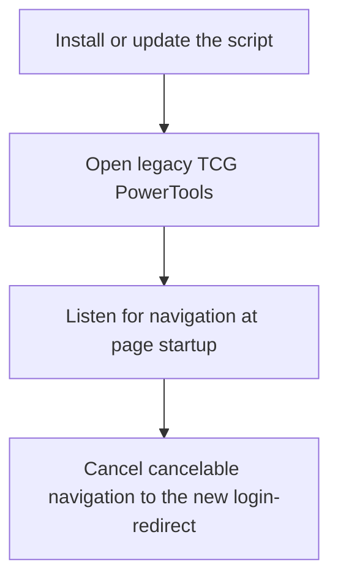

<!-- readme-skill:begin hero -->
# TCG PowerTools - Stay on Legacy App

[English](README.md) · [简体中文](README.zh-CN.md)

Prevent the legacy [TCG PowerTools](https://app.tcgpowertools.com/) page from navigating to `https://new.tcgpowertools.com/login-redirect`. Current version: **1.0.2**.

[Install script](https://raw.githubusercontent.com/tjx0726/P9_Tampermonkey/main/tcgpowertools-block-redirect/tcgpowertools-stay-on-legacy.user.js) · [Source](tcgpowertools-stay-on-legacy.user.js) · [Changelog](../CHANGELOG.md) · [Script catalog](../README.md)
<!-- readme-skill:end hero -->

<!-- readme-skill:begin installation -->
## Installation and usage

1. Enable [Tampermonkey](https://www.tampermonkey.net/) in Chrome or a Chromium browser that supports the Navigation API.
2. Follow **Install script** and confirm installation or an update in Tampermonkey.
3. Ensure the script is enabled and Tampermonkey can access `https://app.tcgpowertools.com/*`. Enable **Allow User Scripts** or the equivalent userscript execution permission required by your browser.
4. Open the legacy app directly and reload it.

At `document-start`, the script registers a listener for the Navigation API's `navigate` event. It calls `preventDefault()` when the destination is the new app's `/login-redirect` or `/login-redirect/` and the navigation is cancelable.



Disable the script and reload the page to stop blocking redirects. The script requires no build step, server, or API key.
<!-- readme-skill:end installation -->

<!-- readme-skill:begin migration -->
## Machines with the old repository version installed

The [original repository](https://github.com/tjx0726/tcgpowertools-block-redirect) continues to serve **1.0.2** at the original script path. Existing `1.0.1` installations can discover the update at that old URL; after installation, their `@updateURL` and `@downloadURL` point to this repository's script. The script name and namespace remain unchanged.

- Enable update checks in Tampermonkey. Enable **Automatic installation** as well if updates should install automatically.
- Migration occurs when each machine next checks for and installs the update. You can manually check for updates to trigger the check sooner.
- After installation, verify that the version is at least `1.0.2` and its update URL contains `P9_Tampermonkey/main/tcgpowertools-block-redirect/`.
- A manually pasted copy without an update source needs a one-time update through this page's install link. Locally modified copies or overridden update URLs may also require manual attention.
- Retain the original file in the old repository so machines that have been offline can migrate later. Future versions only need maintenance in the new repository.

This migration follows the [Tampermonkey maintainer's explanation of update-URL changes](https://github.com/Tampermonkey/tampermonkey/issues/1904). Publishing the repository changes does not establish that every machine has installed the update.
<!-- readme-skill:end migration -->

<!-- readme-skill:begin limitations -->
## Scope and limitations

- Runs only on `app.tcgpowertools.com` and blocks navigation to the new app's specified login-redirect path, including links to that destination clicked on the legacy page. Other destinations are unaffected.
- Uses the browser's Navigation API. If the API is unsupported, it logs an error and does not register a navigation listener.
- Cannot prevent a server redirect before the page loads or navigation marked non-cancelable by the browser. Actual injection timing depends on the browser and Tampermonkey configuration.
- Does not read cookies, change account flags, modify deployed site code, or print tokens from destination URLs to the console.
- Only blocks navigation. Site problems such as repeated user updates or request loops require separate fixes; disable the script and reload if problems occur.
<!-- readme-skill:end limitations -->

<!-- readme-skill:begin maintenance -->
## Local checks and maintenance

Run from this directory:

```sh
node --check tcgpowertools-stay-on-legacy.user.js
```

Version 1.0.2 changes only the version number, homepage, and update URLs; its runtime code is identical to the old repository's 1.0.1. Before publishing, compare both repository copies and verify that the update target is publicly accessible. Actual installation status and extension injection timing need verification in each browser.

For future updates, increase `@version` in this directory's script, preserve the name, namespace, and update URLs, and synchronize the root README and CHANGELOG.
<!-- readme-skill:end maintenance -->
