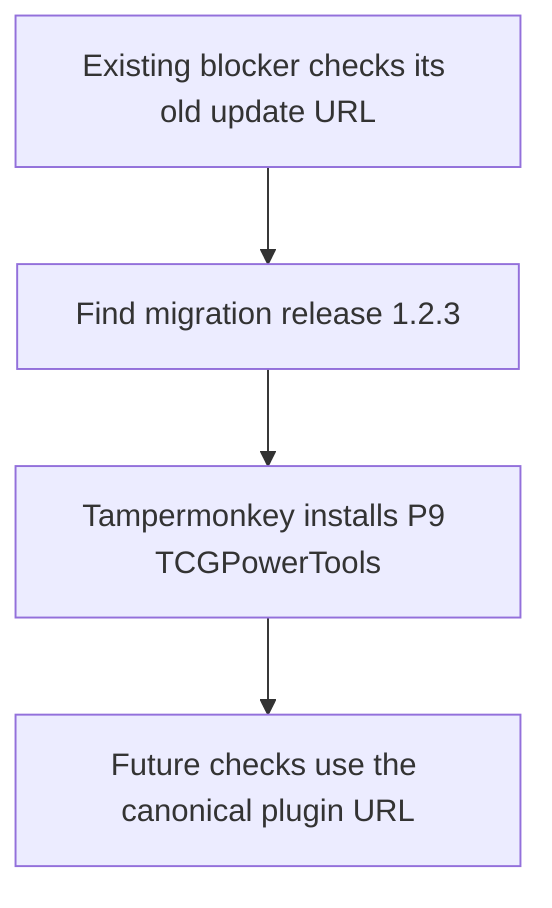

<!-- readme-skill:begin hero -->
# TCG PowerTools - Stay on Legacy App (Deprecated)

[English](README.md) · [中文](README.zh-CN.md)

**Deprecated. New installation is disabled.** This feature is included and enabled by default in [P9 TCGPowerTools](../p9-tcgpowertools/README.md).

~~Install script~~ (disabled — deprecated) · [Replacement plugin](../p9-tcgpowertools/README.md) · [Migration source](tcgpowertools-stay-on-legacy.user.js) · [Changelog](../CHANGELOG.md) · [Script catalog](../README.md)

Migration release: **1.2.3**. The existing update path now serves a complete P9 TCGPowerTools migration copy, with the merged plugin's name, namespace, and canonical update/download URLs.
<!-- readme-skill:end hero -->

<!-- readme-skill:begin installation -->
## Existing installations

1. Keep Tampermonkey update checks enabled. Enable **Automatic installation** if updates should install automatically.
2. Let the next update check run, or choose **Check for updates** for the existing script. No separate installation is needed.
3. Confirm any update-source or permission prompt shown by Tampermonkey. The replacement also supports the new domain and adds tracking, stock, and shared settings features.
4. After updating, reload the site and verify the script is named **P9 TCGPowerTools**, version **1.2.3** or later, with update and download URLs ending in `P9_Tampermonkey/main/p9-tcgpowertools/p9-tcgpowertools.user.js`.



For a new installation, use the replacement plugin's guide above. Do not install this deprecated entry point.
<!-- readme-skill:end installation -->

<!-- readme-skill:begin migration -->
## Original repository installations

The [original repository](https://github.com/tjx0726/tcgpowertools-block-redirect) still serves **1.0.2**, whose update and download URLs point to this repository's retained migration path. A `1.0.1` installation using the original URL first updates to `1.0.2`, then discovers the full-plugin migration on a subsequent update check. An existing `1.0.2` or `1.0.3` installation using this repository can discover the migration directly.

Keep both old paths available for machines that have been offline. Publishing this migration does not establish that every machine has installed it.

The update mechanism follows the Tampermonkey maintainer's explanations of [script renaming and source-change confirmation](https://github.com/Tampermonkey/tampermonkey/discussions/1542) and [update-URL migration](https://github.com/Tampermonkey/tampermonkey/issues/1904).
<!-- readme-skill:end migration -->

<!-- readme-skill:begin limitations -->
## Migration limits

- Update checks and automatic installation depend on each browser's Tampermonkey settings. Confirmation prompts are controlled by the extension.
- A pasted/local copy without an update source, a locally modified script, or an overridden update URL can require a one-time update using the replacement plugin's guide.
- Disabled installations stay subject to Tampermonkey's enabled/disabled state; this migration does not force them to run.
- If the merged plugin is already installed, keep one enabled copy after migration. The shared runtime guard prevents duplicate interfaces and request hooks, but does not delete extension records.
- The migrated script uses the complete merged plugin, including default-on **Stay on Legacy App**. Its supported domains, settings, and limitations are documented in the replacement guide.
<!-- readme-skill:end limitations -->

<!-- readme-skill:begin maintenance -->
## Local checks and maintenance

```sh
node --check tcgpowertools-stay-on-legacy.user.js
cd ../p9-tcgpowertools
npm test
```

On 2026-11-19, a Tabbit browser test with Tampermonkey 5.5.1 updated an existing 1.0.2 installation through its old update URL. After confirming the source and match changes, the same installation record became P9 TCGPowerTools 1.2.3 and stored the canonical update URL. Its disabled state was preserved. An already-installed active plugin remained enabled; only one copy was active after validation.

Keep this complete **1.2.3** migration copy frozen. Future feature releases belong in `p9-tcgpowertools/`; migrated installations follow that canonical update URL. Do not remove the old file or reintroduce its installation link. The regression suite checks migration metadata, independent full-plugin startup, and coexistence in either load order.
<!-- readme-skill:end maintenance -->
