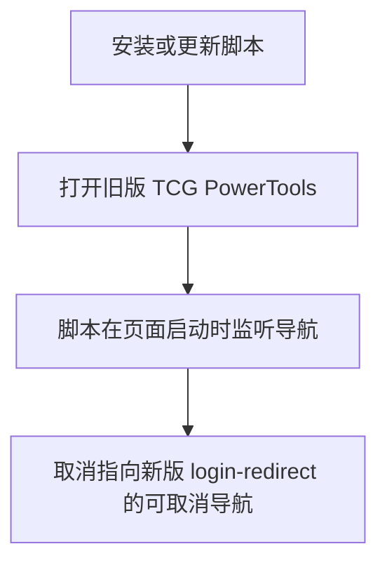

<!-- readme-skill:begin hero -->
# TCG PowerTools - Stay on Legacy App

[English](README.md) · [中文](README.zh-CN.md)

阻止旧版 [TCG PowerTools](https://app.tcgpowertools.com/) 页面跳转到 `https://new.tcgpowertools.com/login-redirect`。当前版本：**1.0.2**。

[安装脚本](https://raw.githubusercontent.com/tjx0726/P9_Tampermonkey/main/tcgpowertools-block-redirect/tcgpowertools-stay-on-legacy.user.js) · [脚本源码](tcgpowertools-stay-on-legacy.user.js) · [更新记录](../CHANGELOG.md) · [返回脚本目录](../README.md)
<!-- readme-skill:end hero -->

<!-- readme-skill:begin installation -->
## 安装与使用

1. 在支持 Navigation API 的 Chrome 或 Chromium 浏览器中启用 [Tampermonkey](https://www.tampermonkey.net/)。
2. 点击「安装脚本」，在 Tampermonkey 中确认安装或更新。
3. 确保脚本已启用，且 Tampermonkey 可访问 `https://app.tcgpowertools.com/*`；按浏览器要求开启 **Allow User Scripts** 或相应的用户脚本执行权限。
4. 直接打开旧版应用并刷新页面。

脚本在 `document-start` 阶段注册 Navigation API 的 `navigate` 监听器。目标是新版的 `/login-redirect` 或 `/login-redirect/` 且导航可取消时，调用 `preventDefault()`。



禁用脚本并刷新网页即可停止拦截。脚本无需构建、服务器或 API key。
<!-- readme-skill:end installation -->

<!-- readme-skill:begin migration -->
## 已安装旧仓库版本的机器

[原仓库](https://github.com/tjx0726/tcgpowertools-block-redirect) 的原始脚本路径继续提供 **1.0.2**。旧版 `1.0.1` 安装可先从旧地址发现更新；安装后，其 `@updateURL` 和 `@downloadURL` 会改为本仓库中的脚本地址。脚本名称和 namespace 保持不变。

- Tampermonkey 需要启用更新检查；如需自动安装，需同时启用 **Automatic installation**。
- 迁移发生在各机器下一次检查并安装更新时。可以手动执行「检查更新」提前触发检查。
- 安装后核对版本至少为 `1.0.2`，更新地址包含 `P9_Tampermonkey/main/tcgpowertools-block-redirect/`。
- 没有更新来源的手动副本，需要通过本页安装链接更新一次；本地改过的副本或被手动覆盖的更新地址也可能需要手动处理。
- 保留旧仓库的原始文件，供长期未联网的机器以后迁移。后续版本只需在新仓库维护。

该迁移机制依据 [Tampermonkey 维护者对更新地址迁移的说明](https://github.com/Tampermonkey/tampermonkey/issues/1904)。仓库发布完成并不能证明每台机器已完成安装。
<!-- readme-skill:end migration -->

<!-- readme-skill:begin limitations -->
## 范围与限制

- 仅在 `app.tcgpowertools.com` 运行，阻止导航到新版应用指定的 login-redirect 路径，包括从旧页面点击该目标链接；其他目标不受影响。
- 使用浏览器的 Navigation API；不支持该 API 时会在控制台报告错误，不会安装拦截监听器。
- 无法阻止页面加载前的服务端重定向，或浏览器标为不可取消的导航。实际注入时机取决于浏览器和 Tampermonkey 配置。
- 不读取 cookies，不修改账户标记，不修改网站部署代码，也不会在控制台输出目标 URL 中的 token。
- 仅阻止跳转。若网站自身存在重复更新用户或循环请求等问题，需要另行处理；出现问题时可先禁用脚本并刷新页面。
<!-- readme-skill:end limitations -->

<!-- readme-skill:begin maintenance -->
## 本地检查与维护

在本目录运行：

```sh
node --check tcgpowertools-stay-on-legacy.user.js
```

1.0.2 仅修改版本号、主页及更新地址；执行代码与旧仓库的 1.0.1 一致。发布前核对两个仓库的脚本内容一致，并验证更新目标可公开读取。各机器的实际安装状态及扩展注入时机需在对应浏览器核对。

后续更新此目录中的脚本时，提高 `@version`，保留名称、namespace 和更新地址，并同步根目录的 README 及 CHANGELOG。
<!-- readme-skill:end maintenance -->
