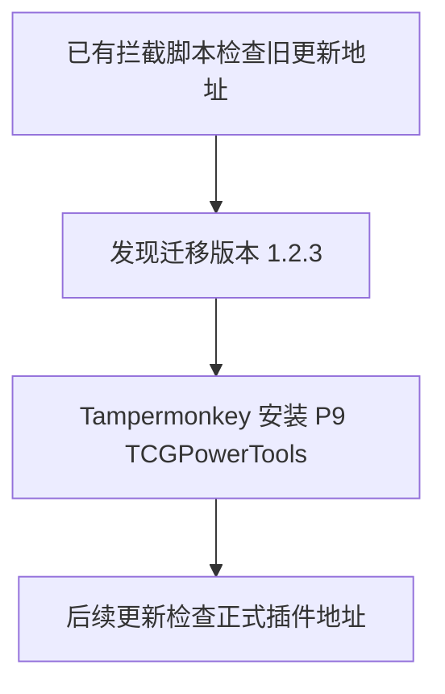

<!-- readme-skill:begin hero -->
# TCG PowerTools - Stay on Legacy App（Deprecated）

[English](README.md) · [中文](README.zh-CN.md)

**Deprecated：已弃用，新安装入口已禁用。** 此功能已合并至 [P9 TCGPowerTools](../p9-tcgpowertools/README.zh-CN.md)，并默认开启。

~~安装脚本~~（已禁用 — deprecated） · [替代插件](../p9-tcgpowertools/README.zh-CN.md) · [迁移版源码](tcgpowertools-stay-on-legacy.user.js) · [更新记录](../CHANGELOG.md) · [返回脚本目录](../README.zh-CN.md)

迁移版本：**1.2.3**。原有更新路径现提供完整的 P9 TCGPowerTools 迁移副本，采用合并插件的名称、namespace 和正式更新／下载地址。
<!-- readme-skill:end hero -->

<!-- readme-skill:begin installation -->
## 已有安装

1. 保持 Tampermonkey 的更新检查开启；如需自动安装，同时启用 **Automatic installation**。
2. 等待下一次更新检查，或对已有脚本执行 **Check for updates**，无需另行安装。
3. 如果 Tampermonkey 显示更新来源或权限确认，请确认更新。替代插件还支持新版域名，并增加 tracking、库存和共享设置功能。
4. 更新后刷新网站，核对脚本名称为 **P9 TCGPowerTools**、版本为 **1.2.3** 或更高，更新和下载地址以 `P9_Tampermonkey/main/p9-tcgpowertools/p9-tcgpowertools.user.js` 结尾。



新安装请使用上方替代插件的说明，不要安装这个已弃用的入口。
<!-- readme-skill:end installation -->

<!-- readme-skill:begin migration -->
## 原仓库安装

[原仓库](https://github.com/tjx0726/tcgpowertools-block-redirect) 继续提供 **1.0.2**，其更新和下载地址指向本仓库保留的迁移路径。仍使用原始地址的 `1.0.1` 安装会先更新到 `1.0.2`，再通过后续更新检查发现完整插件迁移版。已使用本仓库地址的 `1.0.2` 或 `1.0.3` 安装可直接发现迁移。

为长期未联网的机器保留两处旧路径。发布迁移文件不代表每台机器已经完成安装。

更新机制依据 Tampermonkey 维护者对[脚本重命名及来源变化确认](https://github.com/Tampermonkey/tampermonkey/discussions/1542)和[更新地址迁移](https://github.com/Tampermonkey/tampermonkey/issues/1904)的说明。
<!-- readme-skill:end migration -->

<!-- readme-skill:begin limitations -->
## 迁移限制

- 更新检查与自动安装取决于各浏览器的 Tampermonkey 设置，确认弹窗由扩展控制。
- 没有更新来源的粘贴／本地副本、本地修改过的脚本或被覆盖的更新地址，可能需要按照替代插件说明手动更新一次。
- 已禁用的安装仍受 Tampermonkey 启用／禁用状态控制；迁移不会强制启用。
- 如果已经安装合并插件，迁移后只保留一个启用的副本。共享运行时保护会阻止重复界面和请求 hooks，但不会删除扩展中的安装记录。
- 迁移后的脚本采用完整合并插件，包括默认开启的 **Stay on Legacy App**；支持域名、设置和功能限制见替代插件说明。
<!-- readme-skill:end limitations -->

<!-- readme-skill:begin maintenance -->
## 本地检查与维护

```sh
node --check tcgpowertools-stay-on-legacy.user.js
cd ../p9-tcgpowertools
npm test
```

2026-11-19 在 Tabbit 和 Tampermonkey 5.5.1 中，已实测已有 1.0.2 安装通过原更新地址发现迁移。确认来源及匹配范围变化后，同一安装记录变为 P9 TCGPowerTools 1.2.3，并保存正式更新地址。其原有禁用状态得到保留；此前已安装且启用的插件继续保持启用，验证结束时仅有一个副本在运行。

保留并冻结这个完整的 **1.2.3** 迁移副本。后续功能版本在 `p9-tcgpowertools/` 维护，已迁移的安装跟随正式更新地址。不要删除旧文件，也不要恢复其安装链接。回归检查覆盖迁移元数据、完整插件独立启动，以及两种加载顺序下的共存行为。
<!-- readme-skill:end maintenance -->
