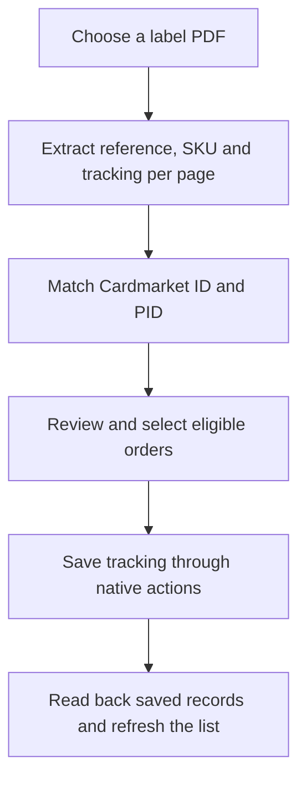

# P9 Order Tools for TCG PowerTools

[English](README.md) · [中文](README.zh-CN.md)

An English Tampermonkey interface for the legacy `https://app.tcgpowertools.com/orders` page. It reads Royal Mail Click & Drop shipping label PDFs, matches orders by Cardmarket ID and PID, and saves tracking numbers. It can run alongside the legacy redirect blocker.

## Installation and updates

1. Install and enable [Tampermonkey](https://www.tampermonkey.net/).
2. Open [Install script](https://raw.githubusercontent.com/tjx0726/P9_Tampermonkey/main/tcgpowertools-tracking/tcgpowertools-royal-mail-tracking.user.js) and confirm installation or update.
3. Reload the legacy orders page and click **P9 Order Tools** at the bottom right.

Version **1.1.2** adds this repository's update URLs. The script name and namespace are preserved. A previously pasted or locally installed copy without an update source needs a one-time installation through the link above; keep only one enabled copy. Future checks use the `main` branch and follow Tampermonkey's local update and automatic-installation settings.

## Menu and use

- **Add Tracking Number** opens the PDF import view.
- **Placeholder** is disabled and reserved for a future feature.
- **Settings** contains the native order-list refresh preference.

Choose a shipping label PDF, review the PID, Cardmarket order ID, PDF tracking, current tracking, and match result, then select the required orders. Enable **Allow overwriting different tracking numbers** when replacing an existing value. Identical values are skipped. **Add tracking to N selected orders** saves selected orders sequentially and verifies the server records.

**Back to Menu** preserves the PDF preview. Navigation and closing are disabled while a PDF is loading or a batch is being saved.



PDFs are read locally. Mozilla PDF.js 5.6.205 and its worker are loaded on demand from jsDelivr; the PDF is not uploaded to that CDN. Saving sends selected order IDs and tracking numbers to the current TCG PowerTools account.

## Settings

**Automatically refresh the order list after native tracking, packed, or sent changes** is enabled by default. Changes take effect immediately and are saved in local storage under `p9.tcg.tracking.autoRefresh`. If storage is unavailable, the setting applies for the current tab.

The script observes successful native XHR/fetch saves, reads `GET /api/user/order`, and updates the existing Zustand store through its public interface. The selected workflow, filters, and search remain in place.

## Matching and saving

All identifiers below are fictional examples.

- One label per page is supported. The original combined reference, `Customer Ref: 90001 / A17 (20) 9900000017`, remains compatible.
- The split format reads the Cardmarket ID from `Customer Ref: 90001 / 9900000017` (or the bare order ID) and the PID from the separate SKU, `A17 (20)`. Royal Mail's prefix, such as `20x A17 (20)`, is kept separate from the order ID. A printed `SKU` heading is optional; PDF field paint order does not affect pairing.
- Missing SKU data, conflicting PID/quantity tokens, or multiple reference headings block the label. Fields are never paired across pages.
- Tracking such as `QM 9000 0001 9GB` is normalized to `QM900000019GB`. Identifiers remain strings, including leading zeros in PIDs.
- The Cardmarket ID must match exactly one order, and its `pt.picking.pickingId` must match the PDF PID. A recycled PID is never the only lookup key.
- Missing orders or fields, PID mismatches, scans without a text layer, ambiguous pages, conflicting labels, and tracking shared across different orders are blocked. Identical duplicate labels are skipped after the first occurrence.
- Selected orders are rechecked before saving. Rows whose tracking changed after the preview are skipped for review.

Saving follows the native tracking dialog's two requests:

1. `PUT /api/user/order/setTrackingNumber` with `{ idOrder, trackingNumber }`.
2. `PUT /api/user/order/changeOrderProp` with `{ idOrder, prop: "trackingNumber", value }`.

The first response must confirm the exact order ID and tracking before the local property is updated. A final GET must confirm the saved local tracking. Failed, partial, or uncertain writes stop the batch and are not automatically retried. Importing tracking does not change packed or sent statuses.

The Cardmarket cache can retain old tracking after a successful save. The script verifies the upstream response and local record separately, then displays the saved local value. It does not rewrite the server's Cardmarket cache.

The already-loaded webpack store is discovered without fixed module IDs or React fibers. A site architecture change may require an adapter update; saving stops before any write if the store cannot be found.

## Validation

```sh
npm run check
npm test
```

The suite has 27 dependency-free checks and two optional PDF integration checks. It covers both reference formats, SKU quantity prefixes, missing/conflicting fields, page boundaries, matching, duplicates, overwrites, upstream confirmation, partial failures, readback, stale caches, native refresh, concurrent saves, and the saved refresh preference.

Real PDFs and independently checked expected records stay outside this public repository. Each expectations file is a JSON array of `{ page, orderCode, cardmarketOrderId, trackingNumber, error }`. Supply both PDFs and their private expectation files to run all 29 checks:

```sh
LABEL_PDF='/private/path/combined-label.pdf' LABEL_EXPECTATIONS='/private/path/combined-expected.json' SPLIT_LABEL_PDF='/private/path/split-label.pdf' SPLIT_LABEL_EXPECTATIONS='/private/path/split-expected.json' PDFJS_MODULE='/absolute/path/to/pdfjs-dist/legacy/build/pdf.mjs' npm test
```

Without the corresponding PDF variable, that integration check is skipped. The public unit tests contain fictional identifiers; actual labels, account records, screenshots, and account-specific fixture generators are excluded.

On 2026-11-19, both the original five-page export and a newly generated split-format Royal Mail label passed local PDF.js extraction. Tabbit and Tampermonkey browser uploads verified the English menu and extracted fields. Earlier five-order save/readback tests restored the original tracking afterward. Packed/sent refresh was checked with simulated requests without changing shipping statuses.

## Disable

Disable or remove this script in Tampermonkey and reload the page to remove its interface and refresh hooks.

References: [Mozilla PDF.js](https://mozilla.github.io/pdf.js/examples/), [Tampermonkey documentation](https://www.tampermonkey.net/documentation.php).
