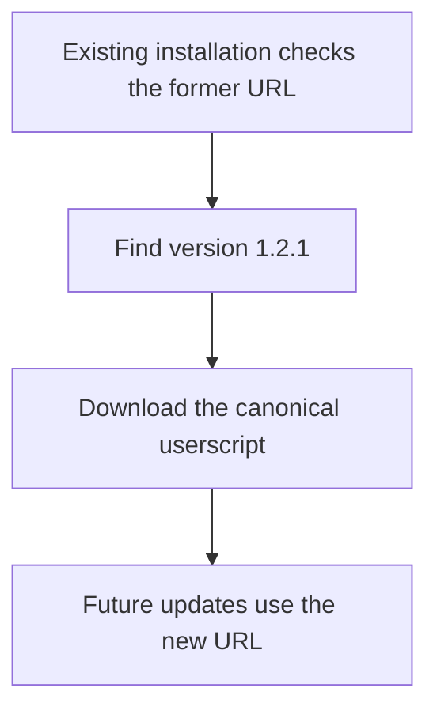

# P9 TCGPowerTools update migration

[English](README.md) · [中文](README.zh-CN.md)

The maintained plugin is in [p9-tcgpowertools](../p9-tcgpowertools/README.md).

[Install or update P9 TCGPowerTools](https://raw.githubusercontent.com/tjx0726/P9_Tampermonkey/main/p9-tcgpowertools/p9-tcgpowertools.user.js).

This directory exists only to preserve the Raw update URL used by older installations. Its complete **1.2.1** userscript has the same name, namespace, and contents as the canonical 1.2.1 release, with update and download URLs pointing to the new directory. After an existing installation updates, later checks use the new URL. Tampermonkey must have update checks enabled; automatic installation depends on local settings.

Keep this migration copy frozen. Make future feature changes in `p9-tcgpowertools/`; do not maintain a second implementation here. The complete copy also keeps direct use of the former URL functional. No extra migration script needs to be enabled.
