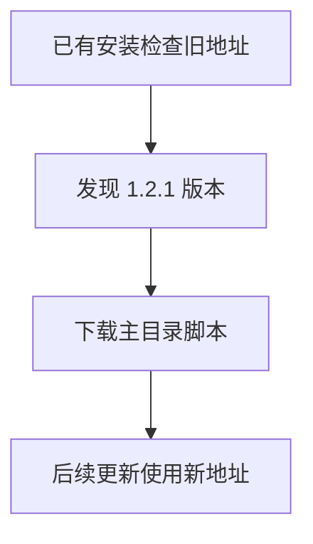

# P9 TCGPowerTools 更新迁移

[English](README.md) · [中文](README.zh-CN.md)

当前维护的插件位于 [p9-tcgpowertools](../p9-tcgpowertools/README.zh-CN.md)。

[安装或更新 P9 TCGPowerTools](https://raw.githubusercontent.com/tjx0726/P9_Tampermonkey/main/p9-tcgpowertools/p9-tcgpowertools.user.js)。

本目录仅用于保留旧安装使用的 Raw 更新地址。这里的完整 **1.2.1** 脚本与主目录 1.2.1 发布版具有相同名称、namespace 和内容，更新及下载地址均指向新目录。已有安装更新后，后续从新地址检查更新。Tampermonkey 必须启用更新检查，是否自动安装取决于本地设置。

保持迁移副本不变。后续功能只在 `p9-tcgpowertools/` 中维护，不在这里开发第二套实现。保留完整副本也能保证直接使用旧地址仍可运行，无需额外启用迁移脚本。
