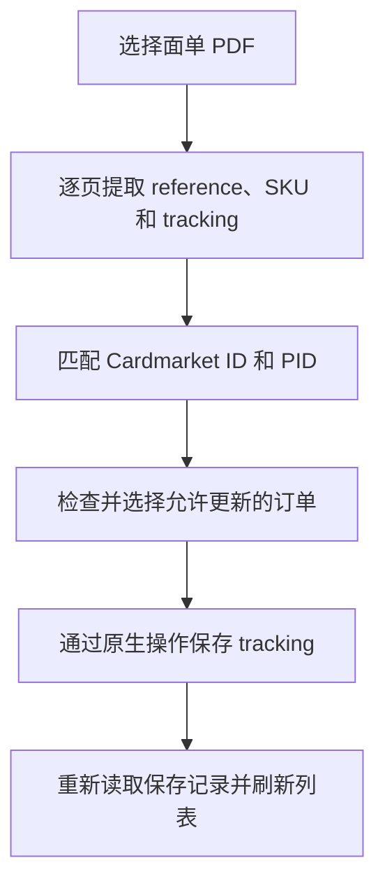

# P9 Order Tools for TCG PowerTools

[English](README.md) · [中文](README.zh-CN.md)

适用于旧版 `https://app.tcgpowertools.com/orders` 页面的英文 Tampermonkey 工具。读取 Royal Mail Click & Drop 邮寄面单 PDF，通过 Cardmarket ID 和 PID 匹配订单并保存 tracking number，可与旧版跳转拦截脚本同时使用。

## 安装与更新

1. 安装并启用 [Tampermonkey](https://www.tampermonkey.net/)。
2. 打开[安装脚本](https://raw.githubusercontent.com/tjx0726/P9_Tampermonkey/main/tcgpowertools-tracking/tcgpowertools-royal-mail-tracking.user.js)，确认安装或更新。
3. 刷新旧版订单页面，点击右下角 **P9 Order Tools**。

版本 **1.1.2** 加入本仓库的更新地址，脚本名称和 namespace 保持不变。原先通过粘贴或本地地址安装、没有更新来源的副本，需要通过上方链接安装一次，并确保只保留一个启用的副本。之后从 `main` 分支检查新版，是否自动安装取决于 Tampermonkey 本地设置。

## 菜单与使用

- **Add Tracking Number** 打开 PDF 导入视图。
- **Placeholder** 禁用，预留给后续功能。
- **Settings** 包含原生操作后的列表刷新设置。

选择邮寄面单 PDF，检查 PID、Cardmarket order ID、PDF tracking、当前 tracking 和匹配结果，然后勾选需要更新的订单。覆盖已有的不同 tracking 时启用 **Allow overwriting different tracking numbers**；相同值自动跳过。点击 **Add tracking to N selected orders**，按顺序保存并重新读取服务器记录验证。

**Back to Menu** 返回菜单并保留 PDF 预览；读取 PDF 或保存批次时暂时禁止切换视图和关闭窗口。



PDF 在本地读取。Mozilla PDF.js 5.6.205 及其 worker 按需从 jsDelivr 加载，PDF 不上传至该 CDN。保存时仅将选中订单的 ID 和 tracking number 发送至当前 TCG PowerTools 账户。

## 设置

**Automatically refresh the order list after native tracking, packed, or sent changes** 默认启用。更改即时生效，并以 `p9.tcg.tracking.autoRefresh` 保存到本地存储。存储不可用时，设置仅对当前标签页生效。

脚本观察成功的原生 XHR/fetch 保存操作，读取 `GET /api/user/order`，通过现有 Zustand store 的公开接口更新列表，保留当前 workflow、筛选和搜索条件。

## 匹配与保存

以下标识符均为虚构示例。

- 支持每页一个面单，兼容旧合并格式 `Customer Ref: 90001 / A17 (20) 9900000017`。
- 新分离格式从 `Customer Ref: 90001 / 9900000017`（或单独订单号）读取 Cardmarket ID，从独立 SKU `A17 (20)` 读取 PID。Royal Mail 自动添加的前缀，例如 `20x A17 (20)`，不会拼入订单号。无需打印 `SKU` 标题，PDF 内部字段绘制顺序不影响配对。
- SKU 缺失、PID/数量标记冲突或多个 reference 标题会阻止处理；不同页面之间不会交叉配对字段。
- `QM 9000 0001 9GB` 等 tracking 会规范为 `QM900000019GB`。标识符保持字符串形式，PID 的前导零会保留。
- Cardmarket ID 必须唯一匹配订单，且订单的 `pt.picking.pickingId` 必须与 PDF PID 相同；不会仅凭可能复用的 PID 查找订单。
- 缺少订单或字段、PID 不符、无文字层扫描件、多候选页面、冲突面单，以及不同订单共用 tracking 等情况会被阻止。完全重复的面单只处理第一次。
- 保存前再次检查选中订单；预览后 tracking 发生变化的订单会跳过，等待人工检查。

保存沿用原生 tracking 对话框的两个请求：

1. `PUT /api/user/order/setTrackingNumber`，内容为 `{ idOrder, trackingNumber }`。
2. `PUT /api/user/order/changeOrderProp`，内容为 `{ idOrder, prop: "trackingNumber", value }`。

第一个响应必须确认准确的订单 ID 和 tracking 后，才更新本地属性；最后通过 GET 确认本地 tracking 已保存。失败、部分成功或结果不确定时停止批次，不自动重试。导入 tracking 不更改 packed 或 sent 状态。

Cardmarket 缓存可能在保存成功后仍包含旧 tracking。脚本分别验证上游响应和本地记录，然后显示已保存的本地值，不改写服务器的 Cardmarket 缓存。

脚本在已加载的 webpack 模块中查找 store，不依赖固定模块 ID 或 React fiber。网站架构变化可能需要调整适配；找不到 store 时会在写入前停止。

## 验证

```sh
npm run check
npm test
```

测试包含 27 项无需依赖的检查和两项可选 PDF 集成检查，覆盖新旧 reference、SKU 数量前缀、字段缺失或冲突、页面边界、匹配、去重、覆盖、上游确认、部分失败、重新读取验证、旧缓存、原生刷新、并发保存和刷新偏好。

实际 PDF 和独立核对的预期记录保留在此公开仓库之外。每份预期文件为 JSON 数组，元素包含 `{ page, orderCode, cardmarketOrderId, trackingNumber, error }`。提供两份 PDF 及对应的私有预期文件，可执行全部 29 项检查：

```sh
LABEL_PDF='/private/path/combined-label.pdf' LABEL_EXPECTATIONS='/private/path/combined-expected.json' SPLIT_LABEL_PDF='/private/path/split-label.pdf' SPLIT_LABEL_EXPECTATIONS='/private/path/split-expected.json' PDFJS_MODULE='/absolute/path/to/pdfjs-dist/legacy/build/pdf.mjs' npm test
```

未提供对应 PDF 变量时跳过该集成检查。公开单元测试使用虚构标识符，不收录实际面单、账户记录、截图或针对具体账户的测试 PDF 生成器。

2026-11-19，原始五页面单和新生成的分离格式 Royal Mail 面单均通过本地 PDF.js 提取验证；在 Tabbit 和 Tampermonkey 中上传 PDF，确认英文菜单和提取字段。此前五笔订单的保存及重新读取测试结束后，已恢复原有 tracking。packed/sent 刷新通过模拟请求验证，未修改邮寄状态。

## 停用

在 Tampermonkey 中禁用或移除此脚本，再刷新页面即可移除界面和刷新钩子。

参考：[Mozilla PDF.js](https://mozilla.github.io/pdf.js/examples/)、[Tampermonkey 文档](https://www.tampermonkey.net/documentation.php)。
